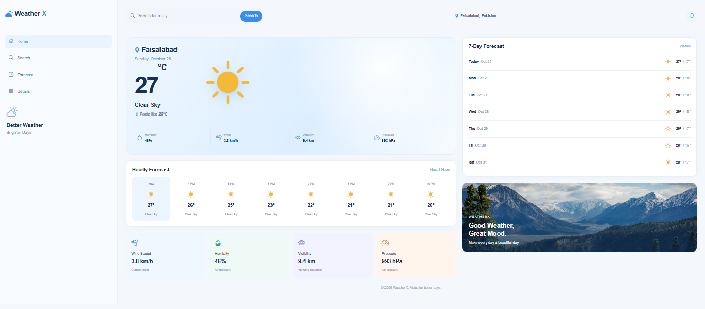
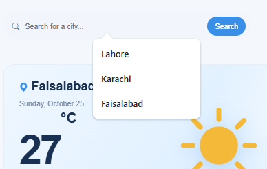
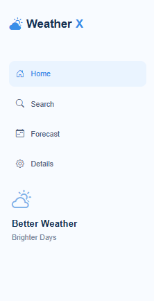
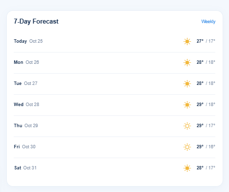
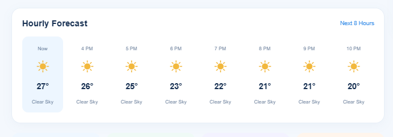
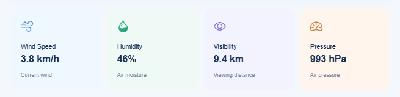

## WeatherX - Weather Dashboard

WeatherX is a responsive weather dashboard that provides real-time weather information and forecasts for different cities. Users can search for a city, view current weather conditions, check hourly and weekly forecasts, and refresh weather data.

## Live Demo

https://weather-application-cyan-zeta.vercel.app/

## Screenshots

<table>
   <tr>
     <td align="center"><b>Home Page</b> </td>
     <td align="center"><b>SearchBar</b> </td>
   </tr>
   <tr>
     <td align="center"><b>SideBar</b> </td>
     <td align="center"><b>Weekly Forecast</b> </td>
   </tr>
   <tr>
     <td align="center"><b>Hourly Forecast</b> </td>
     <td align="center"><b>Weather Details</b> </td>
   </tr>
</table>

## Features

* Search weather by city name.
* Display current temperature and weather conditions.
* Show feels-like temperature, humidity, wind speed, pressure, and visibility.
* Display an 8-hour weather forecast.
* Show a 7-day weather forecast.
* Display weather conditions with matching icons.
* Save the last searched city using Local Storage.
* Refresh weather information with a refresh button.
* Show success and error messages.
* Responsive layout for mobile, tablet, and desktop screens.
* Mobile-friendly collapsible sidebar navigation.

## Technologies Used

* HTML
* CSS
* JavaScript
* Bootstrap

## Author

Laiba Fatima